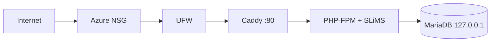

# Architecture v0.2

## Target Architecture (SLiMS di VPS, direncanakan)

Alur: pengunjung membuka katalog lewat browser, Caddy meneruskan
request PHP ke PHP-FPM, SLiMS membaca dan menulis data di MariaDB,
lalu halaman dikirim kembali ke browser.

## Resource Constraints
- 2 vCPU, sekitar 1 GB RAM, disk 61 GB, swap 1 GB
- RAM terbatas: jumlah worker PHP-FPM dan memori MariaDB perlu
  dikecilkan agar tidak kehabisan memori

## Security Decisions
- Administrasi memakai user non-root (cloudstudent)
- SSH hanya dengan key; password dan root login dimatikan
- UFW aktif (port 22 dan 80)
- MariaDB hanya listen di loopback, tidak dibuka ke publik
- Password admin bawaan SLiMS diganti, folder install dihapus
- Password database disimpan di server, bukan di repository
- Deploy key GitHub khusus satu repository

## Current Limitations
- HTTP saja, satu VPS, belum ada backup database
- SLiMS belum terpasang (status: direncanakan)

## Planned Evolution
- M04 DNS + HTTPS
- M05 backup database dan penyimpanan data
- M06 container
- M07 infrastructure as code
- M09 CI/CD

## Riwayat
Baseline M03 (Flask + Gunicorn) diarsipkan di arsip-m03/.
